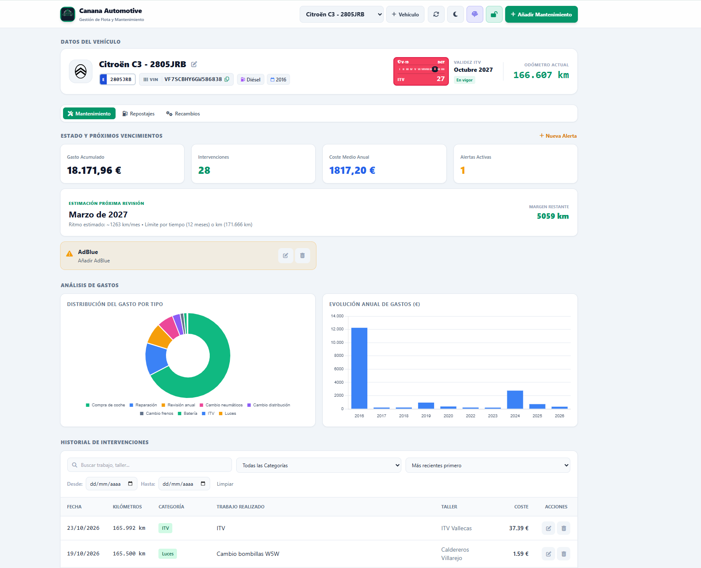
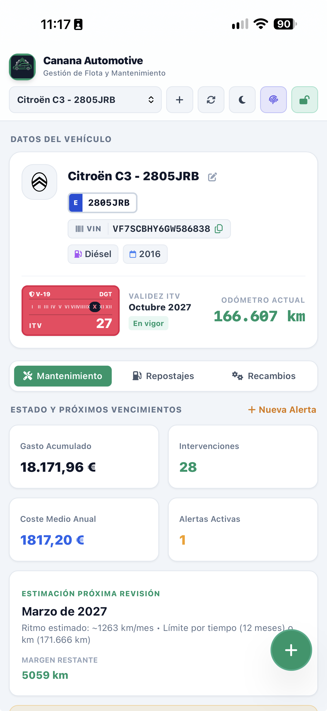

<div align="center">
  
  <h1>Canana Automotive</h1>
  <p><strong>Plataforma PWA para la gestión integral de flota, mantenimiento preventivo, control de consumos y recambios.</strong></p>

  <p>
    
    
    
    
    
  </p>
</div>

---

## Sobre el Proyecto

**Canana Automotive** nace para centralizar el historial técnico y económico de varios vehículos en una única aplicación web progresiva (PWA), pensada tanto para el uso rápido desde el móvil (a pie de surtidor o taller) como para el análisis detallado desde escritorio.

Combina una interfaz ligera *mobile-first* con automatizaciones orientadas a reducir la fricción al registrar datos: escaneo óptico de tickets de combustible, geodetección automática de gasolineras, cálculo del ritmo real de conducción y generación de informes técnicos exportables.

---

## Capturas de Pantalla

> *Vista general del panel de control, distintivo ITV dinámico y analítica de consumos.*

| Vista Escritorio (Dashboard) | Vista Móvil (PWA & Repostajes) |
| :---: | :---: |
|  |  |

---

## Funcionalidades Principales

### 1. Ficha Multi-Vehículo y Distintivo ITV V-19
* **Gestión de flota:** Cambio instantáneo entre vehículos con actualización automática del odómetro global a partir del último repostaje o intervención registrada.
* **Identificación rápida:** Logotipo automático según marca, matrícula en formato europeo y bastidor (VIN) con copia al portapapeles en un toque.
* **Pegatina ITV V-19 Digital:** Renderizado dinámico según normativa DGT (colores rotativos según año de vencimiento) con cálculo de días restantes y alertas visuales progresivas cuando resta menos de un mes o está caducada.

### 2. Mantenimiento Preventivo y Analítica de Gastos
* **Estimación inteligente de próxima revisión:** Calcula el ritmo medio real de uso (`km/mes`) a partir del histórico del vehículo para proyectar la fecha y margen de kilómetros hasta el siguiente servicio.
* **Visualización financiera:** KPIs de gasto acumulado, coste medio anual, distribución por tipo de intervención y evolución anual mediante gráficos interactivos.
* **Búsqueda y filtrado:** Filtrado multicriterio por categoría, taller, descripción, rango de fechas y ordenación por kilometraje o antigüedad.

### 3. Control de Repostajes, OCR y Geolocalización
* **Cálculo exacto de consumo (`L/100km`):** Algoritmo basado en ciclos entre depósitos llenos que acumula correctamente los litros de repostajes parciales intermedios.
* **Escáner OCR de tickets:** Extracción automática en cliente (sin subir imágenes a servidores externos) de importe total, litros, fecha y estación de servicio a partir de una foto del ticket.
* **Geodetección de estaciones:** Localización GPS con coincidencia inteligente frente al histórico personal (< 200 m) y *reverse geocoding* mediante OpenStreetMap.
* **Análisis de precios:** Ranking de estaciones frecuentes, horquilla mínimo/máximo (`€/L`) y curva de evolución del precio del combustible.

### 4. Catálogo de Recambios e Informes
* **Almacén de referencias OEM:** Registro de filtros, aceites y piezas por vehículo con copia directa de referencias y acceso rápido a enlaces de compra.
* **Exportación documental:** Generación bajo demanda de libros **Excel (`.xlsx`)** multi-pestaña e **informes técnicos en PDF** maquetados con cabecera corporativa y logotipo del vehículo.

---

## Arquitectura y Capas Técnicas

Para perfiles técnicos interesados en cómo está construido el proyecto por dentro:

<details>
<summary><strong>1. Stack Frontend & Arquitectura PWA (Zero-Build)</strong></summary>

* **Diseño sin paso de compilación (*Zero-Build*):** Aplicación estructurada sobre HTML5, Vanilla JavaScript (ES6+) y Tailwind CSS vía CDN, optimizada para despliegue directo estático con latencia mínima.
* **Capacidades PWA (`manifest.json` + `sw.js`):** Instalable en iOS y Android con soporte para *safe-areas* (`env(safe-area-inset-*)`), modo oscuro/claro persistente y **App Shortcuts** mediante parámetros URL (`?action=fuel`, `?action=maintenance`) para abrir directamente los modales de registro desde atajos del sistema operativo.
* **Procesamiento en cliente:**
  * `Tesseract.js v5` (idioma español) para reconocimiento óptico de caracteres (OCR) sobre tickets físicos.
  * `Chart.js` para visualización reactiva adaptada al tema activo.
  * `SheetJS (xlsx)` y `jsPDF` para generación de documentos en navegador sin carga en backend.
</details>

<details>
<summary><strong>2. Modelo de Datos y Backend (Supabase)</strong></summary>

La persistencia se apoya en **Supabase (PostgreSQL)** con sincronización en paralelo (`Promise.all`) y normalización de entidades por vehículo:

* `vehiculos`: Ficha técnica, matrícula, VIN, odómetro base e intervalos de mantenimiento (`interval_km`, `interval_months`).
* `mantenimiento`: Histórico de intervenciones, talleres, categorías y costes.
* `repostajes`: Registros de combustible, flag de depósito lleno (`deposito_lleno`) para cálculo de ciclos de consumo y coordenadas (`latitud`, `longitud`).
* `recambios`: Referencias OEM, marcas y URLs de compra por vehículo.
* `alertas`: Vencimientos manuales e integración con el cálculo automático de ITV.
* `profiles`: Gestión de roles (`is_admin`) y credenciales biométricas vinculadas.
</details>

<details>
<summary><strong>3. Seguridad, RLS y Autenticación Biométrica (WebAuthn / Passkeys)</strong></summary>

* **Modelo Lectura Pública / Escritura Protegida:** Cualquier consulta en modo lectura está aislada mediante **Row Level Security (RLS)** en PostgreSQL; las operaciones `INSERT`, `UPDATE` y `DELETE` requieren sesión autenticada y validación de propiedad (`user_id`).
* **Passkeys Multi-Dispositivo (WebAuthn):** Implementación nativa de `navigator.credentials.create()` y `navigator.credentials.get()` vinculando múltiples credenciales por usuario (`passkey_ids`). La verificación criptográfica de la credencial se resuelve mediante una **Supabase Edge Function** (`verify-passkey`) que emite un OTP de sesión tras validar la firma del dispositivo.
</details>

---

## Estructura del Repositorio

```text
mantenimiento/
├── index.html                      # Núcleo de la aplicación (UI, lógica de negocio, OCR, gráficas y exportación)
├── sw.js                           # Service Worker para caché y soporte PWA
├── manifest.json                   # Manifiesto de aplicación web instalable
├── site.webmanifest                # Configuración complementaria de iconos y metadatos
├── apple-touch-icon.png            # Icono principal iOS / PWA
├── web-app-manifest-192x192.png    # Icono PWA 192px
├── web-app-manifest-512x512.png    # Icono PWA 512px
└── screenshots/                    # Capturas de interfaz para documentación
    ├── desktop.png
    └── mobile.png
